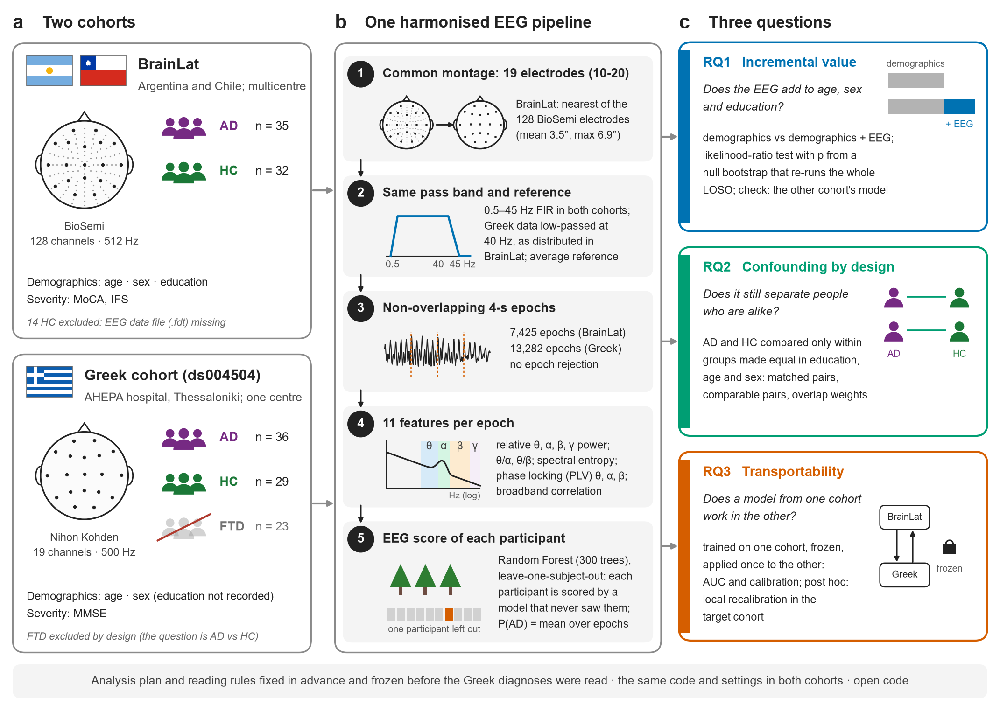

# What Does Resting-State EEG Add to Demographics in Alzheimer's Disease?
### Incremental Value, Confounding, and Transportability Across Two Cohorts

Analysis code for the study above. Everything - from downloading the open dataset to the figures, tables and the
submission material - runs from thirteen Jupyter notebooks that call a small Python package (`src/eegad`).



**Objective.** To determine whether resting-state EEG adds information about Alzheimer's disease (AD) beyond
sociodemographic variables, and whether this added information survives confounder control and transfer across cohorts.

| Question | What is estimated | Notebook |
|---|---|---|
| **RQ1a** | BrainLat: EEG score beyond age, sex and education (OR per 1 SD; p by a null bootstrap of the whole LOSO) | 03 |
| **RQ1b** | Greek cohort (ds004504): beyond age and sex; E-value for education, which was not recorded | 03 |
| RQ1 (independent check) | Score of the model trained on the *other* cohort beyond the demographics | 05 |
| **RQ1c** | Is the incremental effect the same in both cohorts? (pooled model, cohort × EEG) | 03 |
| **RQ2a** | BrainLat: education-matched pairs, comparable pairs, overlap weights (age, sex, education) | 04 |
| **RQ2b** | Greek: overlap weights (age, sex) and comparable pairs (same sex, age ±2 y) | 04 |
| **RQ3a / RQ3b** | Frozen model moved BrainLat => Greek (primary) and Greek → BrainLat | 05 |
| Exploratory | Within AD, does the EEG score track cognitive severity (MoCA, MMSE)? | 06 |
| Sensitivity | 7 spectral features; no gamma; no high-gamma epochs; SVM; XGBoost | 06 |
| *Post hoc (amendment 1)* | Does a local recalibration, without retraining, fix the probabilities of the transported models? | 09 |
| *Post hoc (amendment 2)* | Do the results depend on the Random Forest hyperparameters fixed in the plan? (all shown, none chosen) | 10 |
| *Descriptive (amendment 2)* | Group spectra of the harmonised EEG; angular error of the BrainLat 10-20 correspondence | 11 |

**Design in one paragraph.** Two cohorts: BrainLat (Argentina and Chile; BioSemi 128 channels; Prado et al., 2023) and
the Greek cohort ds004504 (19 channels; Miltiadous et al., 2023); AD and cognitively normal controls only. The same 11
spectral and connectivity features are computed on the 19 positions of the 10-20 system that exist in both cohorts,
with a harmonised pipeline. The primary model is a Random Forest trained with leave-one-subject-out (LOSO) inside each
cohort. The **analysis plan** (`config/analysis_plan.json`) fixes features, model, seeds and the rules used to read each
result; it is frozen before any Greek label is read, and the notebooks refuse to run if it changes.

---

## Repository layout

```
eeg-ad-demographics/
├── README.md
├── config/
│   ├── analysis_plan.json            # the frozen analysis plan (features, model, seeds, reading rules)
│   ├── post_hoc_plan.json            # post hoc amendment 1 (notebook 09); does not edit the plan above
│   ├── post_hoc_plan_2.json          # post hoc amendment 2 (notebooks 10 and 11)
│   ├── paths.example.yaml            # copy to paths.yaml and set your data folders (paths.yaml is not tracked)
│   └── ds004504_v1.0.9_manifest.json # size and SHA-256 of every ds004504 file used
├── notebooks/                        # run in order, 00 -> 12
├── src/eegad/                        # all analysis functions (the notebooks only call them)
├── scripts/
│   ├── run_all.py                    # runs the notebooks without opening Jupyter
│   └── make_synthetic.py             # synthetic data with the structure of both datasets (for testing)
├── tests/                            # pytest: unit tests + an end-to-end run on synthetic data
├── provenance/original_run/          # aggregated outputs of the original analysis (see "Reproducibility")
├── requirements.txt                  # exact versions of the original run
└── outputs/                          # created when you run; never committed (subject-level data)
```

## Data access

**Greek cohort — ds004504 v1.0.9 (OpenNeuro, CC0).** Downloaded automatically by notebook 00 (2.95 GB; only
`participants.tsv` and `derivatives/` are used). Every file is checked by size and SHA-256 against
`config/ds004504_v1.0.9_manifest.json`. If you already have the dataset, point `ds004504_dir` to it: files that match
are only checked, not downloaded again. DOI: [10.18112/openneuro.ds004504.v1.0.9](https://doi.org/10.18112/openneuro.ds004504.v1.0.9).

**BrainLat.** Access is granted by the BrainLat consortium under its data-use terms; see
[Prado et al., 2023](https://doi.org/10.1038/s41597-023-02806-8). Unzip it anywhere and set `brainlat_dir` to the folder
that contains `1_AD` and `5_HC` (in the distributed repository, `.../2_Version/data/raw/brainlat`). Each recording is a
`.set` file with its `.fdt` data file; a `.set` without `.fdt` cannot be read and is reported as excluded.

> **Never commit data.** `outputs/` contains subject-level tables derived from BrainLat and is excluded by
> `.gitignore`, as are `config/paths.yaml` and any EEG file. To share results with co-authors, send
> `outputs/share.zip`, which contains aggregated results only.

## Installation

Python 3.11 is recommended (the original run used 3.11.9; the pinned versions need Python 3.11 or later). In a
terminal, from the repository folder:

**Windows (PowerShell)**
```powershell
py -3.11 -m venv .venv            # or: python -m venv .venv
.\.venv\Scripts\Activate.ps1
python -m pip install --upgrade pip
python -m pip install -r requirements.txt
python -m pip install -e .
```

**macOS / Linux**
```bash
python3 -m venv .venv
source .venv/bin/activate
python -m pip install --upgrade pip
python -m pip install -r requirements.txt
python -m pip install -e .
```

`requirements.txt` pins the library versions of the original run, so that the numbers can be reproduced exactly.
If PowerShell refuses to run `Activate.ps1`, run `Set-ExecutionPolicy -Scope CurrentUser RemoteSigned` once.

## Configuration

```bash
cp config/paths.example.yaml config/paths.yaml      # Windows: copy config\paths.example.yaml config\paths.yaml
```

Edit `config/paths.yaml`. Use forward slashes, also on Windows:

```yaml
brainlat_dir: 'C:/Users/you/data/BrainLat_dataset_Alzheimer_EEG-main/2_Version/data/raw/brainlat'
ds004504_dir: 'C:/Users/you/data/ds004504'
outputs_dir: 'outputs'
n_jobs: -1
download_ds004504: true
quick_test_mode: false
```

The code reads the data from wherever these folders are; nothing needs to be copied into the repository. Environment
variables override the file: `EEGAD_BRAINLAT_DIR`, `EEGAD_DS004504_DIR`, `EEGAD_OUTPUTS_DIR`, `EEGAD_N_JOBS`,
`EEGAD_DOWNLOAD`, `EEGAD_QUICK`.

## Running

Start Jupyter from the activated environment (`jupyter lab`) and run the notebooks in order, or run them all from the
terminal:

```bash
python scripts/run_all.py                # 00 -> 12; executed copies go to outputs/executed_notebooks/
python scripts/run_all.py --from 03      # resume from a notebook (the earlier ones must have run once)
python scripts/run_all.py --from 09      # only the post hoc amendments and the article (09 -> 12; about 30-60 min)
python scripts/run_all.py --from 12      # only the article figures and tables (seconds)
```

`run_all.py` runs the notebooks in the same Python interpreter that runs the script (the activated environment). In
Jupyter, choose the kernel of that environment. A complete first run takes about 5–7 hours on a laptop (most of it in
notebooks 03 and 06); leave it running overnight.

| Notebook | What it does | Time (first run) |
|---|---|---|
| `00_setup_and_data` | Freezes the plan; downloads and verifies ds004504; checks BrainLat | download time |
| `01_cohorts_and_features` | Cohort tables, channel mapping, feature extraction, Table 1, flow diagram, severity, confounding design | 5–15 min |
| `02_eeg_scores_loso` | LOSO Random Forest in each cohort | 10–20 min |
| `03_incremental_value` | RQ1a/b/c with the null bootstrap of the whole LOSO | **30 min to 6 h** |
| `04_confounding_by_design` | RQ2a/b | minutes |
| `05_transportability` | RQ3a/b, independent incremental tests | minutes |
| `06_exploratory_sensitivity` | Exploratory, per-feature and sensitivity analyses | 30–60 min |
| `07_report` | Figures, Table 2, summary, TRIPOD+AI checklist, preprint package | seconds |
| `08_reproduction_check` | Compares every key number with the original run | seconds |
| `09_post_hoc_recalibration` | *Post hoc* amendment 1: local recalibration of the transported models (Table S7) | about 1 min |
| `10_post_hoc_hyperparameters` | *Post hoc* amendment 2A: the pipeline re-run with 10 Random Forest configurations (Table S11, Fig. S5) | 20–40 min |
| `11_descriptive_spectra_and_montage` | Amendment 2B–C: group spectra (Fig. S2) and the montage error map (Fig. S1); reads the EEG again | 5–20 min |
| `12_article_figures_and_tables` | Figures of the article at journal size and all its tables in one Word file | seconds |

Each notebook reads what the previous ones wrote in `outputs/`, so any notebook can be re-run on its own once the
earlier ones have run. Long steps are cached (feature extraction, every LOSO, every null-bootstrap replicate):
if a run stops, running again continues where it stopped. The null bootstrap takes longest when there *is* an effect,
because it then cannot stop early.

`quick_test_mode: true` (or `--quick`) uses fewer trees, replicates and epochs to check that the code runs in minutes.
**Never use its numbers.**

## Outputs

| File | Content |
|---|---|
| `results_summary.md` | Readings by the plan's rules, every result with where it goes in the paper, alerts |
| `tables/T1_participants.csv`, `T1b_severity_by_cohort.csv`, `T1c_greek_mmse_stages.csv` | Participants and cognitive severity |
| `tables/T2_main_results.csv`, `T2b_confounding_by_design.csv` | Main results |
| `tables/F0_participant_flow.csv`, `figures/fig0_participant_flow.pdf` | Participant flow (TRIPOD+AI 20a) |
| `tables/S1`–`S7` | Supplementary tables (channel map, domain shift, balance, exploratory, sensitivity, features, exclusions) |
| `figures/fig1`–`fig3` | ROC curves, incremental odds ratios, confounding-free discrimination (PDF, fonts embedded) |
| `tables/TRIPOD_AI_checklist.*` | TRIPOD+AI checklist with where each item is answered |
| `preprint_package.zip` | Figures, aggregated tables, checklist and draft declarations for medRxiv |
| `share.zip` | Aggregated results only, safe to share |
| `reproduction_check.csv` | Comparison with the original run (notebook 08) |
| `post_hoc/` | Post hoc amendments 1 and 2 (notebooks 09 and 10): frozen amendments, Tables S7 and S11, recalibrated predictions |
| `descriptive/` | Notebook 11: participant spectra (local only), group spectra (`spectra_by_group.csv`, shareable), montage geometry |
| `article/Fig1`–`Fig8`, `FigS1`–`FigS5` | Figures of the article (notebook 12): PDF with embedded fonts and PNG at 300 dpi; Figs. 1 and 2 (schematics) also as SVG with editable text |
| `article/article_tables.docx` | Every table of the article and supplement (Tables 1–5, S1–S12, TRIPOD+AI checklist) and draft figure legends, in one Word file; rewritten at every run |
| `article/supplementary_files/` | The analysis plan and the two post hoc amendments (JSON), for the supplementary information |

## Reproducibility and provenance

The analysis was first run on 2026-11-20 with an earlier, Portuguese-language notebook. Its analysis plan (hash
`fcdd59491d8d1aa8`) was frozen at 10:33:16, before the Greek diagnostic labels were read. This repository is a
refactored English translation of that code. `provenance/original_run/` keeps the original plan, run log, environment,
aggregated tables, figures, a copy of the original notebook and `key_results.json` (546 numbers extracted from the
original outputs).

- **Translation, not re-analysis.** `config/analysis_plan.json` is a one-to-one translation of the original plan
  (keys, feature names and descriptions); all numerical settings, seeds, models and reading rules are unchanged.
- **Verified equivalence.** On identical synthetic data, run both in quick test mode and with the full settings of the
  analysis plan (300 trees, null bootstrap up to B = 199 with sequential stopping, 2,000 bootstrap replicates, all
  epochs), the original notebook and this repository produce bit-for-bit identical features, out-of-fold predictions,
  null-bootstrap statistics, matched pairs and predictions of all 14 transported models, and the same value for all
  546 key numbers.
- **Notebook 08** compares a new run with the original. With the same data and the library versions of
  `requirements.txt`, every compared value should match. Other versions or operating systems may change the last
  decimals of the Random Forest results.
- **Intentional changes** after the original run are listed in [CHANGES.md](CHANGES.md); none affects an inferential
  result.
- **Post hoc amendments.** The recalibration of notebook 09 was decided after the transport results were seen, so it is
  not part of the frozen plan, which is not edited (its hash stays `d694ec84c0e48616`). It has its own plan,
  `config/post_hoc_plan.json`, which states the hash of the plan it amends and is frozen in
  `outputs/post_hoc/post_hoc_plan_frozen.json` on its first run (notebook 09 refuses to run if it changes later). It
  only reads the predictions saved by notebook 05, writes only to `outputs/post_hoc/`, and records no key number, so the
  readings of RQ1–RQ3 and the comparison of notebook 08 are unchanged. It is labelled *post hoc* wherever it appears.
  Amendment 2 (`config/post_hoc_plan_2.json`, notebooks 10 and 11) works the same way: a hyperparameter grid that
  reports every configuration without choosing one (the frozen configuration must reproduce notebooks 02 and 05
  exactly), the group spectra of the harmonised EEG (the files are read again with the same preprocessing code as the
  features) and the montage error map. Only group-level spectra go to the shareable file.

## Testing

```bash
python -m pytest -m "not slow"     # unit tests (seconds)
python -m pytest -m slow           # notebooks 00-12 on small synthetic data, quick mode (minutes)
python scripts/make_synthetic.py ../eegad_synthetic --fdt   # synthetic BrainLat- and ds004504-like folders
```

`make_synthetic.py` prints the environment variables that point the notebooks to the synthetic folders. Keep them
outside the repository.

## Methods and references

| Choice | Why | Reference |
|---|---|---|
| ds004504 `derivatives` (0.5–45 Hz, ASR, ICA), AD and controls | Official description of the dataset | [Miltiadous et al., 2023](https://doi.org/10.3390/data8060095) |
| BrainLat: BioSemi 128, Butterworth 0.5–40 Hz; Greek data low-passed at 40 Hz to match | Official description of the dataset | [Prado et al., 2023](https://doi.org/10.1038/s41597-023-02806-8) |
| LOSO, nested pipeline, several metrics | Validity criteria of the ds004504 benchmark | [Miltiadous et al., 2026](https://doi.org/10.1007/s11571-026-10464-w) |
| Incremental value: logistic demographics vs demographics + score | Testing the new marker's coefficient suffices; testing ΔAUC is redundant | [Vickers et al., 2011](https://doi.org/10.1186/1471-2288-11-13); [Pepe et al., 2013](https://doi.org/10.1002/sim.5727) |
| ML predictions adjusted for confounders at the prediction level | Test of predictions beyond confounders | [Dinga et al., 2020](https://doi.org/10.1101/2020.08.17.255034) |
| p-value by a null bootstrap of the whole LOSO | Tests with cross-validated (pre-validated) scores can be biased | [Höfling & Tibshirani, 2008](https://doi.org/10.1214/07-AOAS152); [Shang et al., 2025](https://arxiv.org/abs/2505.14985) |
| Sequential stopping of the bootstrap | Stops early when p is clearly large | [Besag & Clifford, 1991](https://doi.org/10.1093/biomet/78.2.301) |
| Firth under separation; profile-likelihood CIs | Standard solution for separation | [Heinze & Schemper, 2002](https://doi.org/10.1002/sim.1047) |
| E-value for the unmeasured education | Sensitivity to unmeasured confounding | [VanderWeele & Ding, 2017](https://doi.org/10.7326/M16-2607) |
| One-stage pooled model with cohort-specific terms | Individual-participant data from several studies | [Burke et al., 2017](https://doi.org/10.1002/sim.7141) |
| Score evaluated where confounder and diagnosis are unrelated, without retraining | Confound-free accuracy | [Chyzhyk et al., 2022](https://doi.org/10.1093/gigascience/giac014) |
| 1:1 matching with caliper; pair bootstrap | Matching and variance in matched samples | [Stuart, 2010](https://doi.org/10.1214/09-STS313); [Austin & Small, 2014](https://doi.org/10.1002/sim.6276) |
| Overlap weights | Exact mean balance; focus on the population of overlap | [Li et al., 2018](https://doi.org/10.1080/01621459.2016.1260466) |
| Covariate-adjusted AUC and comparable-pair concordance | Covariate-adjusted accuracy | [Janes & Pepe, 2008](https://doi.org/10.1093/aje/kwn099); [Janes & Pepe, 2009](https://doi.org/10.1093/biomet/asp002) |
| Transport: AUC, calibration slope, calibration-in-the-large, Brier | Calibration hierarchy; sample size for external validation | [Van Calster et al., 2016](https://doi.org/10.1016/j.jclinepi.2015.12.005); [Van Calster et al., 2019](https://doi.org/10.1186/s12916-019-1466-7); [Collins et al., 2016](https://doi.org/10.1002/sim.6787) |
| Reading transport in the light of case-mix differences | Reproducibility vs transportability | [Debray et al., 2015](https://doi.org/10.1016/j.jclinepi.2014.06.018) |
| *Post hoc:* hyperparameters varied one at a time, every configuration reported | Robustness without selection (no tuning on the evaluation data) | [Varma & Simon, 2006](https://doi.org/10.1186/1471-2105-7-91) |
| *Post hoc:* recalibration-in-the-large and logistic recalibration, without retraining | Updating a model in a new setting; simple recalibration often suffices | [Cox, 1958](https://doi.org/10.1093/biomet/45.3-4.562); [Janssen et al., 2008](https://doi.org/10.1016/j.jclinepi.2007.04.018); [Vergouwe et al., 2017](https://doi.org/10.1002/sim.7179) |
| Calibration plot: observed proportion by quintile, Wilson 95% intervals | Interval for a proportion that stays within [0, 1] in small groups | [Wilson, 1927](https://doi.org/10.1080/01621459.1927.10502953) |
| Per-cohort standardisation (secondary) | Site effects in resting-state EEG features | [Jaramillo-Jimenez et al., 2024](https://doi.org/10.1016/j.clinph.2024.09.019) |
| Sensitivity without gamma | Scalp EEG above 20 Hz is dominated by EMG | [Whitham et al., 2007](https://doi.org/10.1016/j.clinph.2007.04.027) |
| The 11 features (relative power, ratios, entropy, synchronisation) | Most consistent resting-state EEG findings in AD | [Babiloni et al., 2021](https://doi.org/10.1002/alz.12311) |
| MMSE stages | MMSE ranges mapped onto CDR stages | [Perneczky et al., 2006](https://doi.org/10.1097/01.JGP.0000192478.82189.a8) |
| Reporting | TRIPOD+AI | [Collins et al., 2024](https://doi.org/10.1136/bmj-2023-078378) |

**Known limitations.** The PLV is sensitive to volume conduction and to the reference
([Stam et al., 2007](https://doi.org/10.1002/hbm.20346)); it was kept to preserve the 11 features of the earlier
conference paper. LOSO AUCs computed by pooling the predictions of all folds can be pessimistic in small samples
([Parker et al., 2007](https://doi.org/10.1186/1471-2105-8-326)); the RQ1 inference does not depend on that AUC. With
35–36 AD per cohort, calibration under transport is imprecise. Differences in equipment, original reference and artefact
cleaning cannot be removed from the distributed files; Table S2 shows their size.

## Citation and license

Code released under the MIT License (see [LICENSE](LICENSE)). If you use it, please cite the article (and the archived
code; see [CITATION.cff](CITATION.cff)), together with the two datasets.
